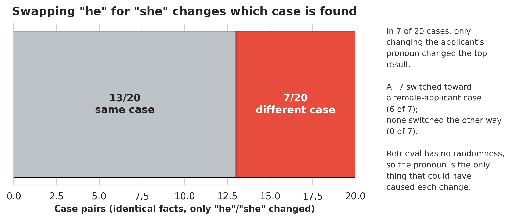
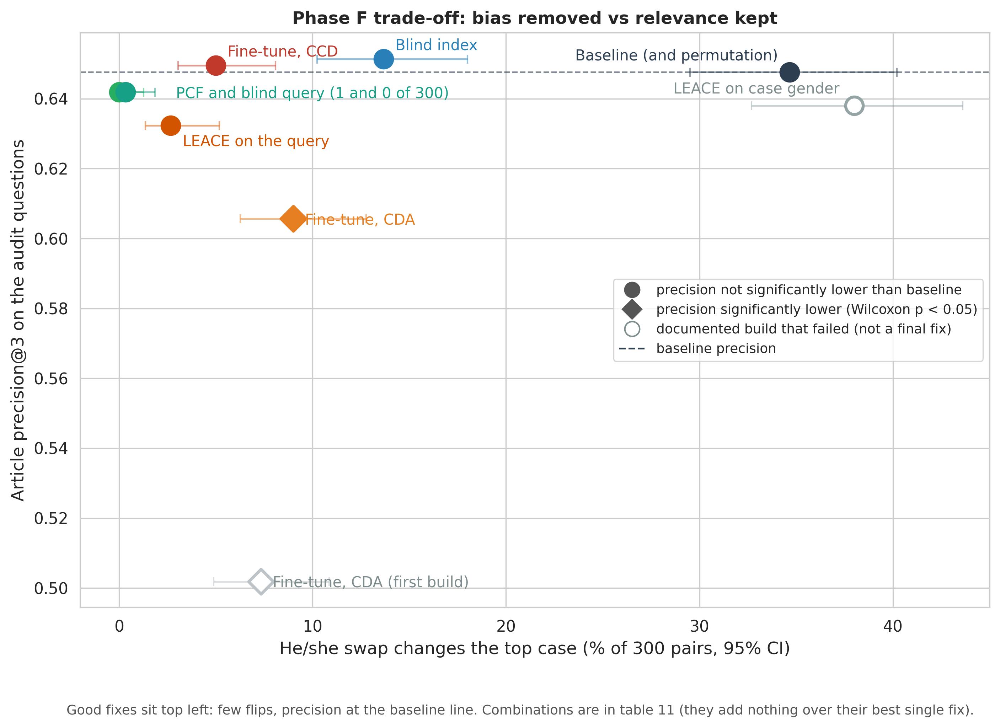

# Gender Bias in a Legal RAG System

**An audit of gender bias in a retrieval-augmented legal assistant, six published fixes compared, and a Claude Code plugin that runs the same audit on any RAG system.**

MSc thesis. The system under audit answers questions on European Court of Human Rights case law: the 9,000 training judgments of the [ECtHR cases dataset](#data) split into 217,903 paragraph chunks, retrieved with FAISS and `nomic-embed-text-v1`, answered by Mistral 7B through Ollama. Every interaction is logged, and every claim is tested against repeat-run noise with exact tests, effect sizes and Holm-Bonferroni correction.



## Findings

| Finding | Evidence |
|---|---|
| **Bias enters at retrieval** | Changing only "he" to "she" changes the top case in 15 of 40 hand-written pairs; all 11 changes of the case's gender go toward a female applicant (exact McNemar, Holm p = 0.0029). On 300 automatic pairs: 104 changes. |
| **It reaches the answer** | The he and she versions of a question cite different cases in 63.7% of 160 pairs, against 2.5% when the same question is asked twice. |
| **The LLM adds no bias of its own** | Given identical cases in the same order, its citations change no more than repeat noise. |
| **The LLM amplifies retrieval** | Given the same cases in a different order, it cites a different case 69% of the time (position bias). |
| **Emotional tone has no effect** | Neither on retrieval nor on the answer. |

Full results: [`docs/bias_audit/results/`](docs/bias_audit/results/) (tables 01–10 and `final_results.json`), charts in [`docs/bias_audit/visualizations/`](docs/bias_audit/visualizations/); the robustness checks R1–R5 in [table 15](docs/bias_audit/results/tables/15_robustness_checks.csv). Every file is listed in [`docs/README.md`](docs/README.md).

## Fixes

Five mitigation methods from the literature and two classic baselines, covering every point of the pipeline. Each is implemented here from its paper, measured on the same tests, and checked for retrieval cost (recall@1, MRR and topical precision of the retrieved cases). Where this setting needed a change from the paper, the change is stated below the table and argued in the thesis.

| Fix | Where it acts | Top case changes (300 pairs) | Answers differ he/she | Retrieval cost |
|---|---|---:|---:|---|
| None (baseline) | | 104 | 63.7% | |
| Blind query, a gender-neutral rewrite [1, 2] | query text | 0 | 1.9% | none |
| PCF [3] | retrieval scores | 1 | 5.0% | none |
| Content conditional debiasing fine-tune [4] | embedder | 15 | 11.2% | none |
| LEACE on the query [5, 6] | query vector | 8 | 13.8% | none |
| Blind index, the same rewrite on every stored chunk | stored documents | 41 | 31.2% | none |
| Counterfactual fine-tune of the embedder [7, 8] | embedder | 27 | 41.2% | lower precision |
| Permutation self-consistency [9] | generation | 104 | 53.1% | none |

Changes from the papers: LEACE erases the he/she direction of the query rather than each document's gender (the paper's setup failed here, 114 changes); the content conditional fine-tune uses a stronger anchor to the original model (the paper's setting found a shortcut) [10]; the counterfactual fine-tune uses label-preserving twins rather than the paper's group-level objective.

The fixes that act on the search reduce the effect, the best ones to near zero, without losing relevance. A fix inside the LLM cannot: the bias is already in the cases it is given. Trade-off table: [`11_mitigation_tradeoff.csv`](docs/bias_audit/results/tables/11_mitigation_tradeoff.csv); details in tables [12](docs/bias_audit/results/tables/12_mitigation_retrieval.csv) (search), [13](docs/bias_audit/results/tables/13_mitigation_whole_system.csv) (answers) and [14](docs/bias_audit/results/tables/14_mitigation_changed_cases.csv) (changed cases), all with their sources in [`mitigation_results.json`](docs/bias_audit/results/mitigation_results.json).



## The audit toolkit

The audit is packaged as a Claude Code plugin. Claude adapts it to your codebase (finds the retriever and the LLM call, adds logging, builds he/she twin questions with you, applies the fixes); fixed scripts do all the statistics, so every audit measures the same thing. On this thesis's data the scripts reproduce the audit exactly (166 of 166 values).

```
/plugin marketplace add dhthz/Legal-RAG-LLM-bias-thesis
/plugin install rag-bias-audit@rag-bias-audit
```

Then, in your RAG project, ask Claude to audit it for gender bias, or run `/rag-bias-audit:bias-audit`. Details: [`toolkit/README.md`](toolkit/README.md).

## Repository

| Path | Contents |
|---|---|
| [`src/`](src/) | The RAG pipeline (chunking, embedding, retrieval, prompting, logging) and the fixes as plain functions (`src/mitigation/`); file map in [`src/README.md`](src/README.md) |
| [`scripts/`](scripts/) | Runnable steps: index building, query construction, the audit statistics and the robustness checks; file map in [`scripts/README.md`](scripts/README.md) |
| [`toolkit/`](toolkit/) | The Claude Code plugin |
| [`docs/`](docs/) | Results, charts, the question sets and the released metadata; index in [`docs/README.md`](docs/README.md) |
| [`tests/`](tests/) | End-to-end test and the frozen-retrieval tripwire; see [`tests/README.md`](tests/README.md) |
| [`FROZEN_BASELINE_MANIFEST.json`](FROZEN_BASELINE_MANIFEST.json) | Every pipeline setting, the index checksum and the prompt variants |

The dataset, the FAISS indices (except the two small LEACE erasers) and the run logs are not in the repository (size, and the dataset's own license); [Reproducing the results](#reproducing-the-results) rebuilds them.

## Data

The judgments come from the **ECtHR cases** dataset of Chalkidis et al. (2019, 2021), [`AUEB-NLP/ecthr_cases`](https://huggingface.co/datasets/AUEB-NLP/ecthr_cases) on Hugging Face (a version of it is also part of [LexGLUE](https://github.com/coastalcph/lex-glue), Chalkidis et al. 2022), built from the Court's public database [HUDOC](https://hudoc.echr.coe.int). It is licensed [CC BY-NC-SA 4.0](https://creativecommons.org/licenses/by-nc-sa/4.0/). The index holds the 9,000 training judgments; the dev and test splits are used for questions and for fitting the fixes, never indexed. Applicant gender was added for the audit: Claude Sonnet 4.5 labelled each judgment from its title and facts (Male, Female, Multiple Applicants, Unknown), the 209 cases it could not settle were labelled by hand, and a hand check of 300 labels confirmed 93.7% (95% CI 90.7–96.8%). Each case also has NRC emotion scores (Mohammad & Turney 2013; the lexicon is free for research use), used to build and check the emotional question variants; tone changed neither the retrieval nor the answer. Summary by applicant gender in [`docs/metadata_reports/nrc_emotion.csv`](docs/metadata_reports/nrc_emotion.csv). Both are released in [`docs/data/case_metadata.csv`](docs/data/case_metadata.csv) (one row per case: gender, `confidence` = `human` for the hand-labelled cases, NRC scores), with the 300-case hand check in [`docs/data/`](docs/data/) (`gender_validation_key.csv`, `gender_validation_tagged.csv`; no case text). Counts in [`docs/metadata_reports/gender_labels.csv`](docs/metadata_reports/gender_labels.csv), charts in [`docs/dataset/visualizations/`](docs/dataset/visualizations/).

## Running it

Python 3.12, CUDA, and Ollama with `mistral` pulled (the thesis used model ID `6577803aa9a0`, shown by `ollama list`; `mistral:latest` may point to a newer model). Download the dataset above into `dataset/` (`train.jsonl`, `dev.jsonl`, `test.jsonl`), then add this work's metadata: `python -m scripts.dataset.case_metadata merge` writes `dataset/train_with_metadata.jsonl`.

```bash
python -m venv thesis_venv && source thesis_venv/bin/activate
pip install -r requirements.txt
python -m scripts.chunking_and_embeddings.run_chunking_pipeline   # build the chunked dataset and the FAISS index (GPU, ~30 min)
python -m scripts.dataset.mergers.merge_metadata_to_chunks      # add the case metadata (gender, NRC) to the chunks
python -m tests.test_frozen_retrieval        # retrieval must match the frozen baseline exactly
python -m tests.test_pipeline                # one question end to end
```

Audit statistics, after the runs in `logs/bias_audit/`:

```bash
python -m scripts.eval.bias_statistics --log <run log> --out-dir <stats dir>
python -m scripts.eval.multi_run_stability && python -m scripts.eval.llm_output_bias
python -m scripts.eval.export_audit_results
```

## Reproducing the results

After the setup under Running it, copy the question sets into `dataset/eval/` and run:

```bash
cp docs/llm_queries/*.jsonl docs/llm_queries/*.csv dataset/eval/

# Phase E: the audit, 4 runs (then the statistics under Running it)
python -m scripts.eval.run_bias_audit --log-path logs/bias_audit/stateless/run40_A.jsonl   # and B, C, D
python -m scripts.eval.run_bias_audit --whole-system

# Phase F: each fix (fixes with their own index or model are built first, scripts/chunking_and_embeddings/)
python -m scripts.eval.mitigation_eval --arms <fix>
python -m scripts.eval.run_bias_audit --arms <fix> --whole-system

# Robustness checks, then the Phase F tables and charts
python -m scripts.eval.robustness_checks --checks r1,r2,r3,r3b,r4,r5
python -m scripts.eval.export_mitigation_results
python -m scripts.dataset.metadata_visualizers.visualize_mitigation
```

Retrieval reproduces exactly; the answers vary within the repeat-run noise reported with each result (temperature 0.1). `retrieval_harness_queries.jsonl` is published without the names removed from each case's facts, so its SHA256 differs from the one in the harness logs; the results do not change.

## References

1. Sun, T., Webster, K., Shah, A., Wang, W. Y., & Johnson, M. (2021). They, Them, Theirs: Rewriting with Gender-Neutral English. [arXiv:2102.06788](https://arxiv.org/abs/2102.06788)
2. Garg, S., Perot, V., Limtiaco, N., Taly, A., Chi, E. H., & Beutel, A. (2019). Counterfactual Fairness in Text Classification through Robustness. *AIES 2019*. [doi:10.1145/3306618.3317950](https://dl.acm.org/doi/10.1145/3306618.3317950)
3. Zhou, Z., Liu, T., Bai, R., Gao, J., Kocaoglu, M., & Inouye, D. I. (2024). Counterfactual Fairness by Combining Factual and Counterfactual Predictions. *NeurIPS 2024*. [arXiv:2409.01977](https://arxiv.org/abs/2409.01977)
4. Deng, W., Chen, B., Zhao, B., Zhang, C., Li, X., & Thrampoulidis, C. (2024). LLM-Assisted Content Conditional Debiasing for Fair Text Embedding. [arXiv:2402.14208](https://arxiv.org/abs/2402.14208)
5. Belrose, N., Schneider-Joseph, D., Ravfogel, S., Cotterell, R., Raff, E., & Biderman, S. (2023). LEACE: Perfect Linear Concept Erasure in Closed Form. *NeurIPS 2023*. [arXiv:2306.03819](https://arxiv.org/abs/2306.03819)
6. Bolukbasi, T., Chang, K.-W., Zou, J., Saligrama, V., & Kalai, A. (2016). Man is to Computer Programmer as Woman is to Homemaker? Debiasing Word Embeddings. *NeurIPS 2016*. [arXiv:1607.06520](https://arxiv.org/abs/1607.06520)
7. Kim, T., Springer, J., Raghunathan, A., & Sap, M. (2025). Mitigating Bias in RAG: Controlling the Embedder. *Findings of ACL 2025*. [arXiv:2502.17390](https://arxiv.org/abs/2502.17390)
8. Zhao, J., Wang, T., Yatskar, M., Ordonez, V., & Chang, K.-W. (2018). Gender Bias in Coreference Resolution: Evaluation and Debiasing Methods. *NAACL 2018*. [arXiv:1804.06876](https://arxiv.org/abs/1804.06876)
9. Tang, R., Zhang, X., Ma, X., Lin, J., & Ture, F. (2024). Found in the Middle: Permutation Self-Consistency Improves Listwise Ranking in Large Language Models. *NAACL 2024*. [arXiv:2310.07712](https://arxiv.org/abs/2310.07712)
10. Kaneko, M., & Bollegala, D. (2021). Debiasing Pre-trained Contextualised Embeddings. *EACL 2021*. [arXiv:2101.09523](https://arxiv.org/abs/2101.09523)

Dataset:

11. Chalkidis, I., Androutsopoulos, I., & Aletras, N. (2019). Neural Legal Judgment Prediction in English. *ACL 2019*. [arXiv:1906.02059](https://arxiv.org/abs/1906.02059)
12. Chalkidis, I., Fergadiotis, M., Tsarapatsanis, D., Aletras, N., Androutsopoulos, I., & Malakasiotis, P. (2021). Paragraph-level Rationale Extraction through Regularization: A case study on European Court of Human Rights Cases. *NAACL 2021*. [arXiv:2103.13084](https://arxiv.org/abs/2103.13084)
13. Chalkidis, I., Jana, A., Hartung, D., Bommarito, M., Androutsopoulos, I., Katz, D. M., & Aletras, N. (2022). LexGLUE: A Benchmark Dataset for Legal Language Understanding in English. *ACL 2022*. [arXiv:2110.00976](https://arxiv.org/abs/2110.00976)

Built with: [FAISS](https://github.com/facebookresearch/faiss), [nomic-embed-text-v1](https://huggingface.co/nomic-ai/nomic-embed-text-v1), [Mistral 7B](https://mistral.ai/news/announcing-mistral-7b) through [Ollama](https://ollama.com), [spaCy](https://spacy.io), GPT-2 (for the rewrite), and the LEACE authors' [concept-erasure](https://github.com/EleutherAI/concept-erasure) library.

## Status

- Audit and fixes: complete.
- Toolkit: v0.1, reproduces the thesis audit exactly, and was tested from a fresh session on a second, unseen RAG system (a Bias in Bios search app).
- Gender is the validated attribute. The system is English-only and ECtHR-only, with one embedder and one LLM.
